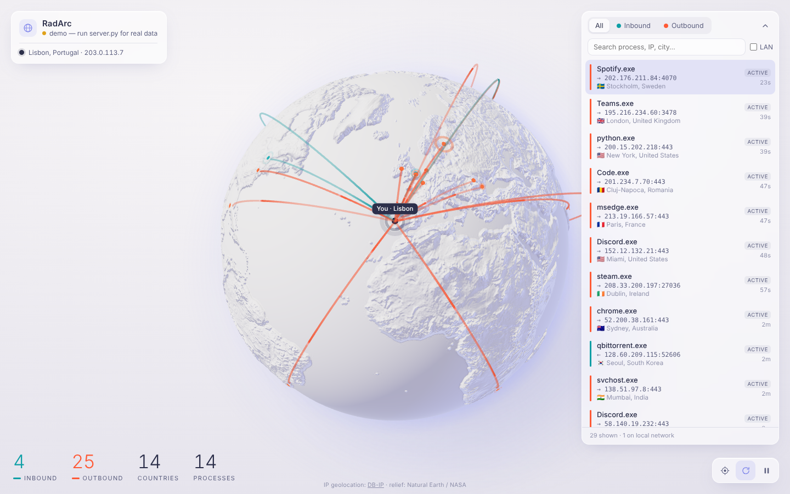

# RadArc

**See who your PC is talking to, live, as arcs on a porcelain globe.**

RadArc is a small local app. A Python script reads your computer's active network connections, finds where each remote IP is in the world (offline), and streams them to a 3D globe in your browser. Every connection becomes an arc from your location to the other end.



- **Outbound** connections (your PC started them) are drawn in coral.
- **Inbound** connections (someone connected to a port your PC listens on) are drawn in teal.
- A light pulse runs along each arc in the direction of the connection.
- Arcs get thicker when several connections go to the same city.
- A side list shows each connection's process, remote IP and port, city and country, state, and age. You can filter and search it.

## Quick start (Windows)

1. Install [Python 3.9+](https://www.python.org/downloads/) (tick "Add to PATH").
2. Double-click **`start.bat`**.
   - The first run installs `psutil` and `maxminddb`.
   - It also downloads the free DB-IP Lite city database (~60 MB, once) into `data/`.
3. Your browser opens at <http://127.0.0.1:8765/>.

Use **`start-admin.bat`** to also see the names of system processes (svchost, etc.).

On macOS or Linux:

```bash
python3 -m pip install -r requirements.txt
python3 server.py
```

## Your location

RadArc finds your location from your public IP (one request to api.ipify.org). ISPs often put an IP in the wrong city. To fix your location, copy `config.example.json` to `config.json` and set `home` to your real coordinates.

## Privacy

- IP geolocation runs **offline**, from the `.mmdb` file in `data/`. Your connection list never leaves your machine.
- `--online` (or `"online_geo": true` in the config) sends only the IPs missing from the offline database to ip-api.com. It is off by default.
- The server listens only on `127.0.0.1`, so nothing on your network can reach it.

## Options

```
python server.py --port 8765 --interval 1.0 --online --no-browser
```

| Option | Default | What it does |
|---|---|---|
| `--port` | 8765 | Local port for the web page |
| `--interval` | 1.0 | Seconds between connection scans |
| `--online` | off | Use ip-api.com for IPs not found offline |
| `--no-browser` | off | Don't open the browser automatically |

If the GeoIP download fails, get **IP to City Lite (MMDB)** from [db-ip.com](https://db-ip.com/db/download/ip-to-city-lite) and put the `.mmdb` file in `data/`. MaxMind's `GeoLite2-City.mmdb` works too.

Open <http://127.0.0.1:8765/?demo> to see simulated data. Add `?glow=0` to turn off the glow under the continents, or e.g. `?glow=1.5` to make it stronger.

## Controls

- **Drag** to rotate the globe. **Scroll** to zoom.
- **Hover** an arc to see its processes, IPs and location.
- **Click** an arc or a list row to fly to that location.
- Bottom-right buttons: center on you, auto-rotate, freeze updates.

## How it decides inbound vs. outbound

A TCP connection counts as **inbound** when its local port is one your PC is listening on. Everything else counts as **outbound**. Loopback traffic is ignored. LAN connections are counted and can be shown in the list (tick **LAN**), but they get no arc.

## Project layout

```
server.py            local server: psutil + GeoIP + Server-Sent Events
web/index.html       page
web/app.js           globe, arcs, list (three.js)
web/style.css        UI styles
web/tex/             relief height, normal and AO maps
web/lib/             three.js (bundled, so it works offline)
```

## Credits

- IP geolocation: [DB-IP](https://db-ip.com) Lite, licensed CC BY 4.0
- Relief: NASA topography and [Natural Earth](https://www.naturalearthdata.com/) coastlines (public domain), with the topography map taken from [three-globe](https://github.com/vasturiano/three-globe)'s examples
- Rendering: [three.js](https://threejs.org) (MIT)

## License

MIT © Bidian M. Calin
